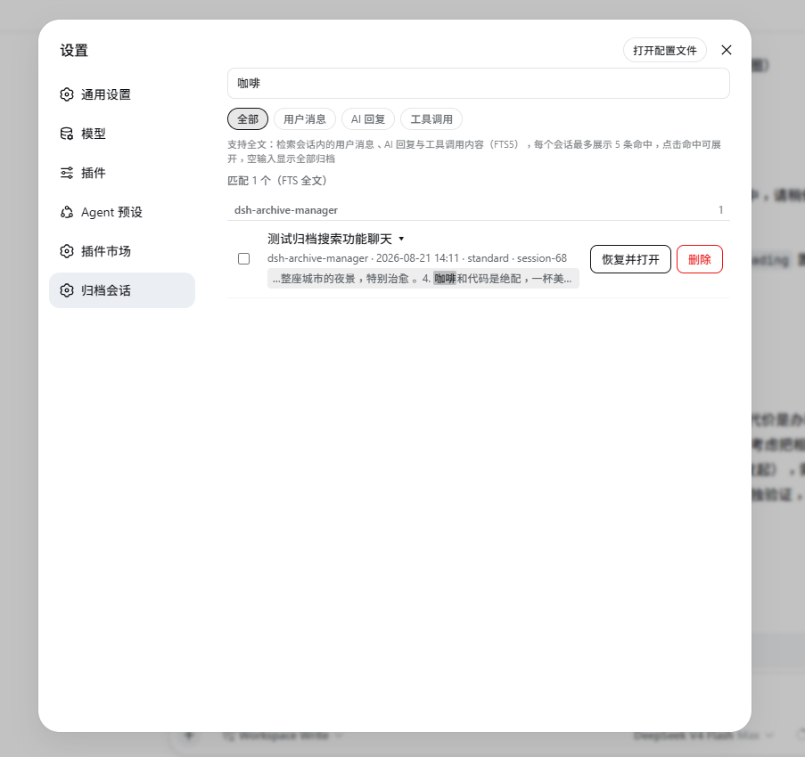
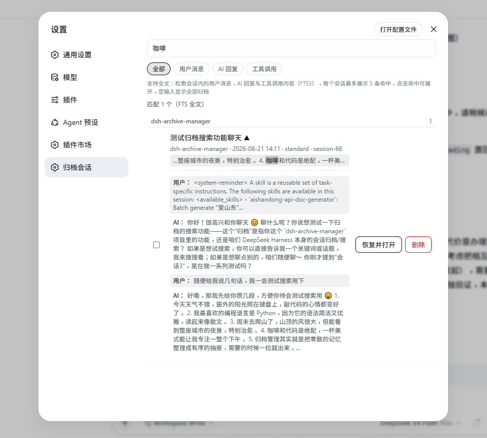

# dsh-archive-manager

[English](./README.en.md) · **中文**

[](https://www.npmjs.com/package/@chushiz/dsh-archive-manager)
[](https://github.com/deepseek-ai/deepseek-harness)
[](./LICENSE)

DSH 的「归档」只能把会话藏起来，没法取消。这个插件在 **设置 > 归档会话** 里补齐浏览、搜索、恢复和删除，还能自动归档不再用的旧会话。

## 功能

- **浏览** —— 按项目分组列出已归档会话，分组可折叠；列表打开很快，不会等每个会话日志加载完。
- **搜索** —— 搜聊天内容、标题、目录；命中处高亮，可按用户消息 / AI 回复 / 工具调用筛选。
- **预览** —— 点标题展开最近几条用户 / AI 消息，不用恢复就能判断是不是要找的会话。
- **恢复并打开** —— 取消归档并打开，看历史、接着聊。
- **批量删除** —— 勾选多个一起删。删除会真正移除会话，**不可逆**。
- **自动归档** —— 按闲置天数或每个项目保留的数量，自动把旧会话收进归档。置顶和正在使用的会话不会被归档；刚恢复的会话也有一段时间不会被再次归档。
- **在插件页直接配置** —— 打开 **插件 → dsh-archive-manager** 就能改自动归档设置，保存后立即生效，不用编辑配置文件。





## 安装

在 DSH 的插件市场搜索 **dsh-archive-manager** 安装，或在命令行执行：

```sh
dsh plugin --profile web add @chushiz/dsh-archive-manager
```

安装后刷新页面；如果没出现，重启一次 DSH。

## 使用

打开 **设置 > 归档会话**：可以浏览、搜索、预览、恢复或删除归档会话。

## 自动归档

打开 **插件 → dsh-archive-manager**，在「归档管理配置」里打开「启用自动归档」即可。默认关闭。

可以设置：

| 设置 | 默认 | 说明 |
| --- | --- | --- |
| 闲置天数 | 5 天 | 超过这么多天没用过的会话自动归档；填 0 表示不按时间归档 |
| 每个项目保留 | 0 | 每个项目最多保留多少个未归档会话，超出的归档最旧的；填 0 表示不限制 |
| 保护期（天） | 1 天 | 最近这段时间用过的会话不会被归档 |
| 扫描间隔（分钟） | 60 | 多久检查一次 |
| 启动后首次延迟（毫秒） | 60000 | 启动后多久开始第一次检查 |

满足上面任一条件就会归档，随时可以在 **设置 > 归档会话** 里恢复。不想等定时检查时，可以点「立即扫描」手动执行一次（会先确认）。

## 兼容性

| DSH 版本 | 状态 |
| --- | --- |
| 0.2.1-rc.5 | ✅ 本机实测 |
| 0.2.1-rc.3 | ✅ 实测过 |
| 0.2.0-rc.2 | ✅ 实测过 |
| 其他 0.2.x | 大致可用，建议用上面的版本 |

## License

MIT
